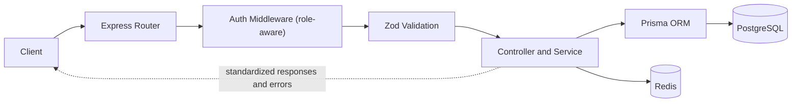

<!-- ============ BANNER ============ -->

**I build reliable APIs and the full-stack applications around them — well-modelled data, secure auth, payment integrations, and code that's easy to maintain and extend.**

---

## 👨‍💻 About

I'm a software engineer with a backend-first mindset. I like the parts of a system that users never see but always feel — the data model, the API contract, and the error handling that keeps everything steady when things go wrong. I build the backend and the Next.js frontend that consumes it, so I can take a feature from schema to screen.

|                           |                                                                                             |
| ------------------------- | ------------------------------------------------------------------------------------------- |
| 🔧 **Core stack**         | TypeScript · Node.js · Express 5 · Prisma · PostgreSQL · Next.js                            |
| 🛠️ **Currently building** | A doctor-appointment platform (Express + Prisma backend, Next.js frontend)                  |
| 💬 **Ask me about**       | REST API design, role-based access control, relational data modelling, payment integrations |
| 📍 **Location**           | Sylhet, Bangladesh (UTC+6)                                                                  |
| 🤝 **Availability**       | Freelance projects and contract engagements                                                 |

---

## 🧠 How I Work

| Focus Area                | Practice                                                                                               | What You Get                                                                             |
| ------------------------- | ------------------------------------------------------------------------------------------------------ | ---------------------------------------------------------------------------------------- |
| **API design**            | Resource-oriented REST endpoints, schema validation with Zod, consistent error responses               | APIs that front-end and third-party teams can integrate without guesswork                |
| **Auth & access control** | JWT access/refresh tokens, httpOnly cookies, role-aware middleware that re-checks live user status     | Secure, role-based systems (customers, managers, admins) that are enforced on the server |
| **Data integrity**        | ERD-first schemas, `prisma.$transaction()` around multi-step flows, soft deletes                       | Operations that don't leave half-finished state or double-book a resource                |
| **Performance**           | Composite indexes on hot queries, Redis for short-lived state like OTPs and tokens                     | Responsive endpoints and fewer redundant round-trips                                     |
| **Integrations**          | Stripe Checkout with webhooks, bKash tokenized checkout, Cloudinary uploads, transactional email       | Real payment and notification flows, not just CRUD                                       |
| **Delivery**              | Clear scoping, regular progress updates, AI-assisted tooling for scaffolding (always reviewed by hand) | Predictable delivery without cutting corners                                             |

**Request flow in my API projects:**

---

## 🛠️ Tech Stack

| Layer                | Technologies                                                                                           |
| -------------------- | ------------------------------------------------------------------------------------------------------ |
| **Languages**        | TypeScript · JavaScript · SQL · HTML · CSS                                                             |
| **Frontend**         | Next.js (App Router, Server Components, Server Actions) · React · Tailwind CSS · shadcn/ui · Bootstrap |
| **Backend**          | Node.js · Express 5 · REST API design · Prisma ORM · Zod                                               |
| **Databases**        | PostgreSQL · Redis · MySQL · MongoDB                                                                   |
| **Auth & Security**  | JWT (access + refresh) · httpOnly cookies · bcrypt · role-based access control                         |
| **Integrations**     | Stripe (Checkout + webhooks) · bKash · Cloudinary · Nodemailer                                         |
| **Tooling & Deploy** | Git · GitHub · Postman · VS Code · Vercel                                                              |

---

## 🚀 Featured Projects

Full-stack projects, each split into a backend API and a Next.js frontend:

| Project                                                          | What It Does                                                                                                                                                                                                                                                                                                                                                                                                                                         | Stack                                                                              | Links                                                                                                                                                                                                                                                                       |
| ---------------------------------------------------------------- | ---------------------------------------------------------------------------------------------------------------------------------------------------------------------------------------------------------------------------------------------------------------------------------------------------------------------------------------------------------------------------------------------------------------------------------------------------- | ---------------------------------------------------------------------------------- | --------------------------------------------------------------------------------------------------------------------------------------------------------------------------------------------------------------------------------------------------------------------------- |
| **⚡ Load Shedding & Outage Management** _Backend + frontend_ | Models an electricity distribution hierarchy (Zone → Substation → Feeder → Area) with planned load-shedding schedules, customer-reported outages with technician dispatch, and prepaid token recharge via bKash. Four-role access control. Multi-step flows run inside `prisma.$transaction()` to prevent race conditions such as double-assigning a technician; composite indexes keep dispatch queries fast; Redis caches OTPs and payment tokens. | `Express 5` `TypeScript` `Prisma 7` `PostgreSQL` `Redis` `Zod` `bKash` `Next.js`   | [Backend](https://github.com/mdamranahmad/phl2b7m43a6-loadshedding-and-power-management-backend) · [Frontend](https://github.com/mdamranahmad/phl2b7a7-loadshedding-and-power-management-system) 🌐 [Live Demo](https://loadshedding-and-power-management-s.vercel.app/) |
| **🏘️ RentNest** _Backend + frontend_                          | Rental marketplace for tenants, landlords and admins. The API handles the rental-request lifecycle and Stripe Checkout with webhooks. The Next.js 16 frontend provides role-based dashboards, property search and filtering, and middleware-enforced route protection using httpOnly JWT cookies.                                                                                                                                                    | `Express 5` `Prisma 7` `PostgreSQL` `Stripe` `Next.js 16` `Tailwind 4` `shadcn/ui` | [Backend](https://github.com/mdamranahmad/PHL2B7M26A04-RentNest) · [Frontend](https://github.com/mdamranahmad/phl2b7m33a05-rentnest-frontend) [Live Demo](https://rentnest-zeta.vercel.app/)                                                                             |
| **📰 Prisma Press** _Backend + frontend_                      | Blog platform with a Prisma-backed API and a Next.js App Router frontend featuring auth and blog pages.                                                                                                                                                                                                                                                                                                                                              | `Next.js` `TypeScript` `Prisma`                                                    | [Backend](https://github.com/mdamranahmad/PHL2B7M20-Prisma-Press) · [Frontend](https://github.com/mdamranahmad/phl2b7m27-prisma-press-frontend) <!-- 🌐 [Live Demo](ADD_PRISMA_PRESS_URL) -->                                                                            |
| **🧮 PayScale 2026 Salary Calculator** _Real-world utility_   | Single-file, client-side calculator for pay fixation, phased implementation, arrears, and gross salary under Bangladesh's National Pay Scale 2026.                                                                                                                                                                                                                                                                                                   | `HTML` `CSS` `JavaScript`                                                          | [Source](https://github.com/mdamranahmad/Salary-Calculator-For-PayScale-2026) · 🌐 [Live](https://mdamranahmad.github.io/Salary-Calculator-For-PayScale-2026/)                                                                                                              |
| **🎟️ Football Ticket Booking** _Database design_              | ERD-first relational design for a ticket-booking platform, modelling Users, Matches, and Bookings with explicit constraints, plus a suite of queries covering booking logic.                                                                                                                                                                                                                                                                         | `TypeScript` `SQL`                                                                 | [Source](https://github.com/mdamranahmad/PH-L2B7A3-Module17-Footbal-Ticket-Booking-System)                                                                                                                                                                                  |
| **🤖 Developer Portfolio** _AI-assisted build_                | A responsive personal portfolio built through an AI-assisted workflow — showing how I direct AI tooling to ship clean, working output quickly.                                                                                                                                                                                                                                                                                                       | `HTML` `CSS` `JavaScript`                                                          | [Source](https://github.com/mdamranahmad/WebDev-Portfolio-V0) · 🌐 [Live](https://mdamranahmad.github.io/WebDev-Portfolio-V0/)                                                                                                                                              |

<b>In progress & earlier work</b>

 

- 🏥 **PH Healthcare System** _(in progress)_ — Doctor-appointment platform. [Backend](https://github.com/mdamranahmad/phl2b7m34-project-ph-healthcare-system-backend) (Express 5, Prisma 7, PostgreSQL, JWT — patient registration, login and profile are working so far) · [Next.js Frontend](https://github.com/mdamranahmad/phl2b7m44-ph-healthcare-frontend)
- 📊 **[DevPulse](https://github.com/mdamranahmad/PH-L2B7-M10-A2-DevPulse)** — TypeScript application tracking developer activity insights · [Live Demo](https://b7a2-devpulse.vercel.app/)
- 🏢 **[Modern Real Estate Website](https://github.com/ahmad-v0/sc-assignment-1-modern-real-estate-website)** — Responsive landing page built with Bootstrap · [Live Demo](https://ahmad-v0.github.io/sc-assignment-1-modern-real-estate-website/)
- 🎮 **[React Tic-Tac-Toe](https://github.com/mdamranahmad/REACT-PRACTICE-BASIC-TIC-TAC-TOE)** — React fundamentals practice: state, props, and component composition

---

## 📈 GitHub Activity

 

---

## 🤝 Let's Work Together

I'm available for **freelance projects and contract engagements**. If you need an engineer who can design the data model, build the API, wire up payments and auth, and ship the frontend that uses it — let's talk.

|                         📧 Email                          |                              💼 LinkedIn                               |                             🌐 Portfolio                              |                       👤 Facebook                       |
| :-------------------------------------------------------: | :--------------------------------------------------------------------: | :-------------------------------------------------------------------: | :-----------------------------------------------------: |
| [amranahmad.md@gmail.com](mailto:amranahmad.md@gmail.com) | [md-amran-ahmad](https://www.linkedin.com/in/md-amran-ahmad-6724a9a6/) | [View portfolio](https://mdamranahmad.github.io/WebDev-Portfolio-V0/) | [amran.ahmad.5](https://www.facebook.com/amran.ahmad.5) |

**💬 Have a project in mind? [Send me an email](mailto:amranahmad.md@gmail.com) — I usually reply within 24 hours.**

